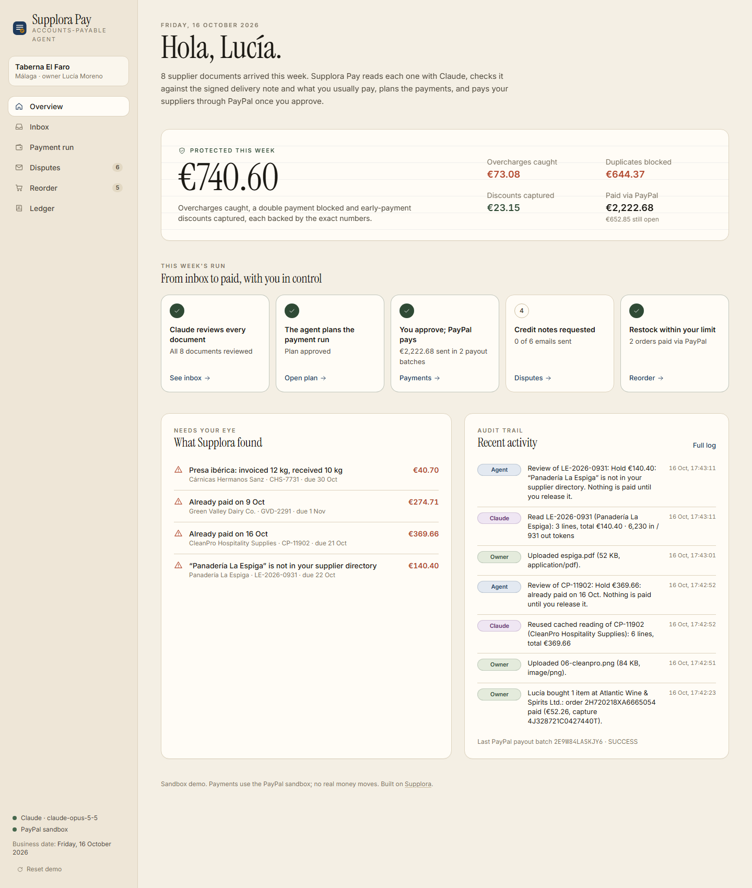
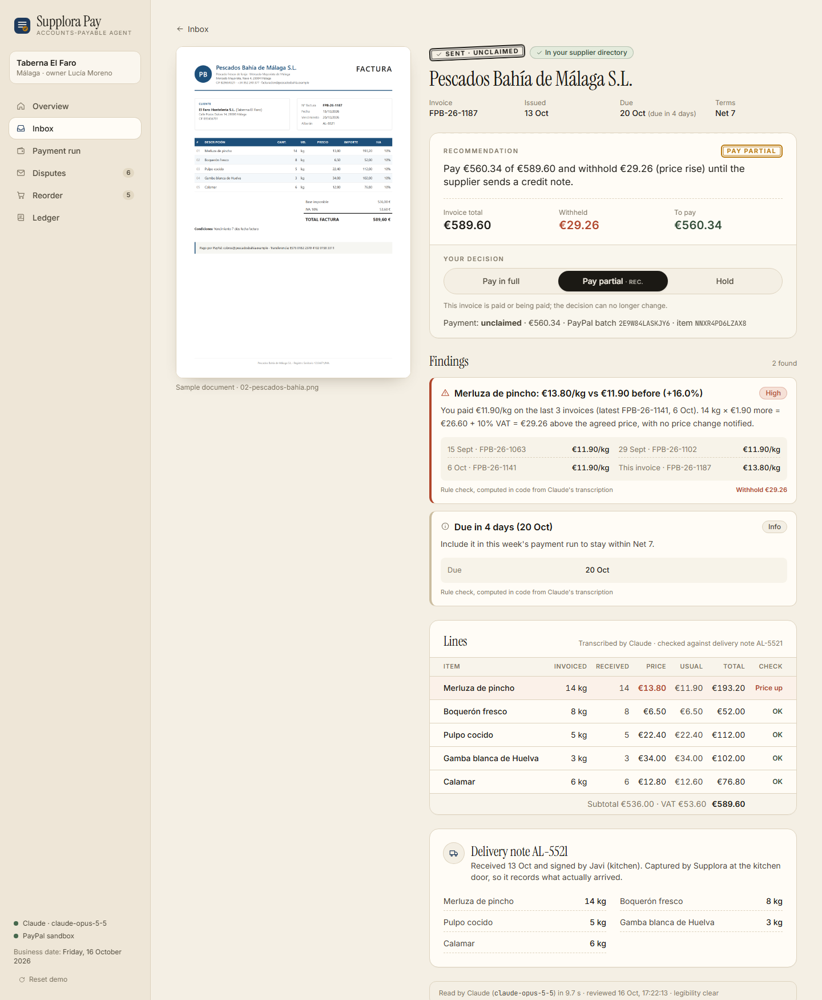
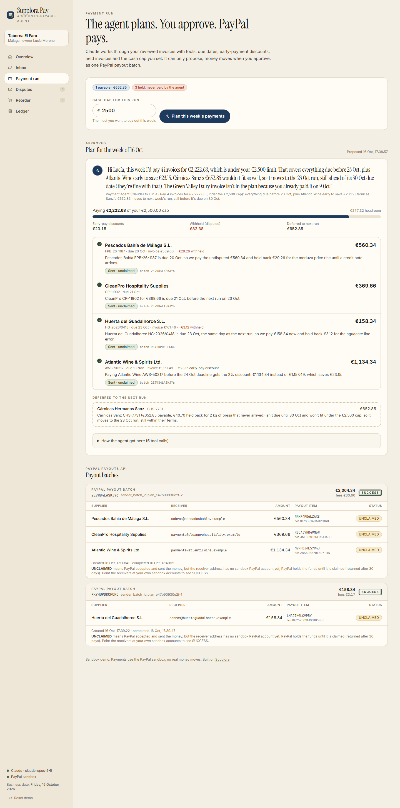
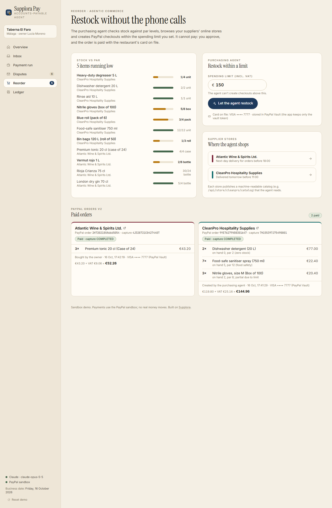

# Supplora Pay: the accounts-payable agent for independent restaurants

> An independent restaurant pays dozens of suppliers by hand every week. Nobody checks the hake price against last week's, nobody notices that 12 kg were invoiced and 10 kg arrived, the same invoice gets paid twice, and the 2% early-payment discount quietly expires.
>
> **Supplora Pay reads every supplier invoice with Claude, checks it against the signed delivery note and the restaurant's price history, plans the week's payments within a cash cap, and pays suppliers through PayPal once the owner approves.** A purchasing agent restocks what's running low from suppliers' online stores, within a spending limit, also paid through PayPal after approval.

Built for the **PayPal AI Hackathon** (2026) · categories: *Best Use of Agentic Commerce* and *Best Use of PayPal + AI*.



---

## Why this is a real problem

Supplora Pay grows out of [Supplora](https://www.supplora.app), an AI tool already used every day by a restaurant in Spain. Supplora reads the supplier delivery notes (*albaranes*) at the kitchen door and pushes them into the restaurant's ERP: **715 delivery notes processed and €1,876 in supplier price increases detected** so far. The obvious next question from the owner was: *"if you already know what arrived and what it should cost, why am I still paying invoices by hand?"*

Supplora Pay closes that loop: **read → verify → plan → approve → pay → follow up.**

## What the owner gets

| Step | What happens | Where |
|---|---|---|
| **1. Inbox** | Supplier invoices arrive (6 realistic samples ship with the app; upload a phone photo or PDF for more). | `/inbox` |
| **2. AI review** | Claude (vision) transcribes each document and maps the supplier and every line to the restaurant's directory. Deterministic checks then compare it with price history, the signed delivery note and payment history, and recommend **pay in full / pay partial / hold**, with every finding citing the exact numbers. | `/inbox/[id]` |
| **3. Payment run** | A Claude agent with tools builds the week's plan: due dates first, early-payment discounts captured, held invoices excluded, the owner's cash cap respected. **Nothing is paid until the owner approves** (one payment or all). Approved payments go out as one **PayPal Payouts** batch; batch and item status are polled live. | `/payments` |
| **4. Disputes** | For held and partially paid invoices, Claude drafts a polite credit-note request in the supplier's language with the evidence. Copy it, open it in your mail app, mark it sent. | `/disputes` |
| **5. Agentic reorder** | A purchasing agent checks stock against par, reads the suppliers' store catalogs and creates **PayPal Orders v2** checkouts within a spending limit. It cannot pay: on approval the order is confirmed with the restaurant's card on file (a **PayPal Vault** token) and captured. | `/reorder`, `/store/[supplier]` |
| **6. Ledger** | Paid, held and disputed amounts, money saved, and an audit log of every agent decision and every PayPal API call (method, endpoint, status, resource id, idempotency key, debug id; never credentials). | `/ledger` |

### The six sample invoices (and what Supplora Pay catches)

| Supplier | Issue built into the document | Outcome |
|---|---|---|
| Huerta del Guadalhorce (produce, ES) | `6 kg × €4.20` printed as `€28.20` | Pay partial: withhold **€3.12** (€3.00 + 4% VAT) |
| Pescados Bahía (fish, ES) | Hake at €13.80/kg vs €11.90 on the last 3 invoices | Pay partial: withhold **€29.26** (14 kg × €1.90 + 10% VAT) |
| Cárnicas Hermanos Sanz (meat, ES) | 12 kg of presa invoiced, 10 kg on the signed delivery note AL-3307 | Pay partial: withhold **€40.70** |
| Green Valley Dairy (EN) | "Payment reminder · copy" of an invoice already paid on 9 Oct | **Hold** €274.71 (duplicate) |
| Atlantic Wine & Spirits (EN) | 2/10 net 30 terms | Pay **€1,134.34 by 24 Oct** instead of €1,157.49: saves **€23.15** |
| CleanPro (EN) | none | Pay in full |

With the default €2,500 cash cap, the payment agent pays the three invoices due before the next run plus Atlantic Wine early (capturing the discount) and defers Cárnicas Sanz (due 30 Oct) to next week: **€2,222.68**.



---

## How PayPal is used

All PayPal calls are server-side REST calls with client credentials (`src/lib/paypal.ts`). The OAuth token is cached until shortly before it expires; every write carries a `PayPal-Request-Id` idempotency key; every call is written to the audit log.

| Need | PayPal API | Calls |
|---|---|---|
| Authenticate | OAuth 2.0 client credentials | `POST /v1/oauth2/token` (cached) |
| Pay suppliers in one go after approval | **Payouts** | `POST /v1/payments/payouts` (unique `sender_batch_id`, `recipient_type: EMAIL`, `sender_item_id` = invoice), `GET /v1/payments/payouts/{batch_id}` polled until final |
| Keep the restaurant's card on file without storing card data | **Vault v3** | `POST /v3/vault/setup-tokens` → `POST /v3/vault/payment-tokens` (the app keeps only the vault token id) |
| Agent checkout at a supplier store | **Orders v2** | `POST /v2/checkout/orders` (intent `CAPTURE`, items, VAT breakdown) by the agent → on owner approval `POST /v2/checkout/orders/{id}/confirm-payment-source` with the vault token → `POST /v2/checkout/orders/{id}/capture` |

**Why this split matters for agentic commerce:** the agent can *create* a checkout (a real PayPal order in `CREATED` state, visible to the owner with its id) but has no tool that confirms or captures it. Money only moves through the owner's approval route.



## How Claude is used

Model `claude-opus-5-5` via the official `@anthropic-ai/sdk`, `output_config.effort: "medium"`, adaptive thinking (default on this model), no forced `tool_choice`.

| Job | Technique | Code |
|---|---|---|
| Read any supplier document (photo or PDF, Spanish or English) | Vision + structured output: `client.messages.parse` with `zodOutputFormat` (image or PDF base64 block). Claude transcribes **exactly what is printed** (it must not fix errors) and maps supplier and lines to the directory; it also reports things only visible on the document (e.g. a "copy/reminder" stamp, payment details on an unusual domain). Results are cached by file hash. | `src/lib/review.ts` |
| Verify | **Not Claude:** deterministic rules in integer cents (arithmetic, price vs history with 2% tolerance, quantity vs signed delivery note, duplicates in history and inbox, unknown supplier, changed payment details, discounts, due dates). Every finding carries its evidence. 10 unit tests. | `src/lib/checks.ts` |
| Plan the payment run | **Tool runner agent** (`client.beta.messages.toolRunner` + `betaZodTool`): `get_open_invoices`, `get_cash_position`, `get_supplier`, `propose_payment_plan` (validates cap, holds, discount windows, completeness and computes every amount in code; returns errors for the agent to fix), `request_approval`. Progress notes stream to the UI as NDJSON. | `src/lib/planner.ts` |
| Restock | **Tool runner agent**: `check_inventory`, `browse_store` (the store's public catalog feed), `create_checkout` (prices from the catalog, never from the model; enforces the spending limit; creates the PayPal order), `submit_for_approval`. | `src/lib/restock.ts` |
| Ask for credit notes | `messages.parse` → `{subject, body}` in the supplier's language, only from the facts provided. | `src/lib/disputes.ts` |

Agent runs use the server-side refusal fallback (`fallbacks: "default"`) and `thinking.display: "updates"` for short progress notes.

### Guardrails (human in the loop by design)

- **Agents never move money.** No agent tool confirms, captures or pays. Payouts and captures happen only in the owner's approval routes.
- **Amounts are computed in code**, not by the model: payable = invoice − withheld lines (− discount if the window is open), re-validated at approval time against the current state and the cash cap.
- **Payment destinations come from the supplier directory, never from the document.** An invoice asking to be paid somewhere else is held as *payment details changed* (the classic invoice fraud); unknown suppliers and duplicates are held too.
- **Spending limits** (cash cap for payouts, limit for restock) are enforced by the tools, so the agent gets an error and must adapt.
- Sandbox only (the app refuses non-sandbox PayPal URLs), secrets only on the server, same-origin check on every write, uploads type-checked by magic bytes and size-limited.



---

## Architecture

```
Browser (Next.js App Router, React 19, Tailwind 4)
  │  server components read state; client components call route handlers
  ▼
Route handlers (/app/api/*)  ──same-origin check, input validation──┐
  │                                                                  │
  ├─ review     → Claude vision (messages.parse + Zod) → rules engine (checks.ts)
  ├─ payment-run→ Claude tool runner ── tools ── state (read) / plan validation
  │                                   └─ request_approval → plan "awaiting approval"
  ├─ plans/[id]/approve (owner) → PayPal Payouts POST → poll GET → invoices paid
  ├─ restock    → Claude tool runner ── create_checkout → PayPal Orders v2 (CREATED)
  ├─ restock/[id] approve (owner) → Vault token → confirm-payment-source → capture
  └─ disputes   → Claude messages.parse → email draft
  │
  ▼
.data/state.json (local JSON store, atomic writes) · .data/claude-cache · audit log
```

## Run it locally

Requirements: Node 22.18+ (tested on Node 24; `npm test` and `npm run samples` use Node's built-in TypeScript type stripping), an Anthropic API key, and a PayPal **sandbox** REST app (developer.paypal.com → Apps & Credentials → Sandbox).

```bash
npm install
cp .env.example .env.local      # then fill in the keys
npm run dev                     # http://localhost:3300
```

`.env.local`:

```
ANTHROPIC_API_KEY=...
PAYPAL_CLIENT_ID=...            # sandbox app
PAYPAL_CLIENT_SECRET=...
PAYPAL_BASE_URL=https://api-m.sandbox.paypal.com
# optional
# PAYPAL_PAYOUT_RECEIVER_OVERRIDE=sb-xxxx@personal.example.com
# DEMO_TODAY=2026-10-16
```

**3-minute demo:** Inbox → *Review 6 with Claude* → open the fish invoice → Payment run → *Plan this week's payments* → *Approve & pay* → watch the batch go `PENDING → SUCCESS` → Disputes → *Draft the email with Claude* → Reorder → *Let the agent restock* → *Approve & pay* → Ledger. *Reset demo* (sidebar) starts over; Claude readings stay cached, so a second run of the inbox is instant and free.

### Sandbox notes

- **Currency:** EUR everywhere (verified in the sandbox for both Payouts and Orders).
- **Payout receivers** use the reserved `.example` domain (see `src/data/seed.ts`). The sandbox accepts the payout and the batch completes with `SUCCESS`, while each item ends as `UNCLAIMED` (`RECEIVER_UNREGISTERED`): PayPal holds the money until someone registers that address, and returns it after 30 days. To see items end as `SUCCESS`, put your own sandbox personal/business account emails in `seed.ts`, or set `PAYPAL_PAYOUT_RECEIVER_OVERRIDE` to send every payout to one sandbox account.
- **Card on file:** on the first approved order the app vaults PayPal's public sandbox test card `4012 0000 7777 7777` (expiry 2029-12) with Vault v3 and from then on only uses the vault token. Storefront orders settle to the sandbox app's own merchant account; in production each supplier would be its own PayPal merchant (e.g. via PayPal Commerce Platform with `payee` set per store).
- **Business date:** the sample invoices are dated around Friday 16 Oct 2026, so the demo uses that as "today" (override with `DEMO_TODAY`).

### Evidence from a real sandbox run (16 Oct 2026)

| What | PayPal ids |
|---|---|
| Payout batch, 1 approved payment (€158.34) | batch `RKYHUPDKCFCKC` → `SUCCESS`, item `LMA27H9LCVP5Y` |
| Payout batch, 3 approved payments (€2,064.34) | batch `2E9W84LASKJY6` → `SUCCESS`, items `NNXR4PD6LZAX8`, `RSJAJYHR49N6W`, `MVKFDJ4E5794U` |
| Agent checkout at CleanPro (€144.96) | order `9YE76279V08301647` `CREATED` → confirmed with vault token → capture `7H155397J75490001` `COMPLETED` |
| Owner checkout at Atlantic Wine (€52.26) | order `2H720218XA6665054` → capture `4J328721C0427440T` `COMPLETED` |

## Quality checks

```bash
npm test          # rules engine: 10 tests on the six samples and edge cases
npm run typecheck # next typegen + tsc
npm run lint
npm run build
```

## Project structure

```
src/app/(app)/        overview, inbox, review, payments, disputes, reorder, ledger
src/app/store/        simulated supplier storefronts (merchant side)
src/app/api/          route handlers (review, payment-run, approve, payouts, restock, store, disputes)
src/lib/checks.ts     deterministic review rules (+ checks.test.ts)
src/lib/review.ts     Claude vision extraction
src/lib/planner.ts    payment-run agent
src/lib/restock.ts    purchasing agent + Orders v2 checkout
src/lib/paypal.ts     PayPal REST client (OAuth cache, idempotency, audit)
src/data/seed.ts      supplier directory, price history, delivery notes, stores, inventory
scripts/generate-samples.mjs   renders the sample invoices (headless Chrome)
```

## Limitations

- Single-restaurant demo with a local JSON store; a real deployment needs a database, authentication and per-user roles.
- Supplier PayPal receivers in the seed data are placeholders; onboarding suppliers' PayPal accounts is the next step.
- Delivery notes, price history and inventory are seeded; in production they come from Supplora's live ERP integration.

## Who built it

Antonio González Fernández, Business Administration + Data Science student (CUNEF, Madrid), founder of Supplora.

## License

MIT, see [LICENSE](LICENSE).
